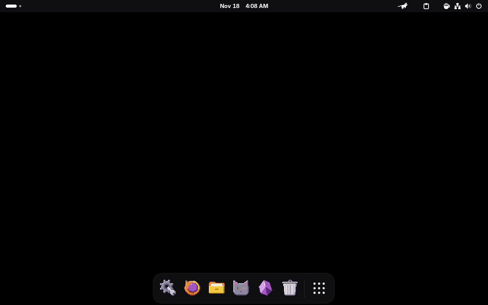

# Glacier
 
A minimal, dark-themed GNOME desktop built on **Fedora 45**.
Try it live from a USB stick, or install it to disk as a normal, updatable
Fedora system (`dnf5` + Flatpak).
 


 
## Features
 
- Fedora 45 with GNOME 51
- Dark theme: `adw-gtk3-dark`, Inter, JetBrains Mono, OmaPixIcon icons
- Kitty terminal, a pinned dock, and GNOME Shell extensions: Blur my Shell, RunCat, Clipboard History, Caffeine, Dash to Dock, GSConnect
- Neovim with LazyVim ready to use
- Discord and RustDesk from Flathub, installed automatically on first boot (needs a network connection)
- The live ISO boots on UEFI and BIOS machines (x86_64); the installer is UEFI-only
- Installer in the terminal: LUKS2 encryption, Btrfs
## Included apps
 
Firefox, VLC, Loupe, Kitty, Nautilus, Neovim, Lazygit, Btop, Fastfetch, Marknote, and more.
 
## Editions
 
| | Minimal | Dev |
| --- | :---: | :---: |
| Desktop and apps | ✓ | ✓ |
| Git, Python 3, gcc, make, curl, wget | ✓ | ✓ |
| g++, clang, cmake, ninja, gdb, lldb, valgrind, pip, Python and OpenSSL headers | | ✓ |
 
## Download
 
Get an ISO and `SHA256SUMS` from the
[Releases](https://github.com/xenxaarn/glacier/releases) page, then verify it:
 
```sh
sha256sum -c SHA256SUMS --ignore-missing
```
 
## Install

Boot the ISO and the installer opens in Kitty (or run **Install Glacier** from
the dock). It asks for a disk, hostname, user, password, timezone and keyboard
layout, then wipes the disk and installs: 512 MiB EFI partition, 1 GiB `/boot`,
the rest LUKS2 with Btrfs (`@`, `@home`). UEFI only. The log is
`/tmp/glacier-installer.log`.

## Building from source
 
Requires Podman or Docker:
 
```sh
./build.sh                  # minimal edition
./build.sh --profile dev    # dev edition
```
 
Other modes: `--native` (on a Fedora host) and `--boxbuild`.
The ISO and a `SHA256SUMS` file are written to `output/`.
 
## License
 
[MIT](LICENSE)
 
