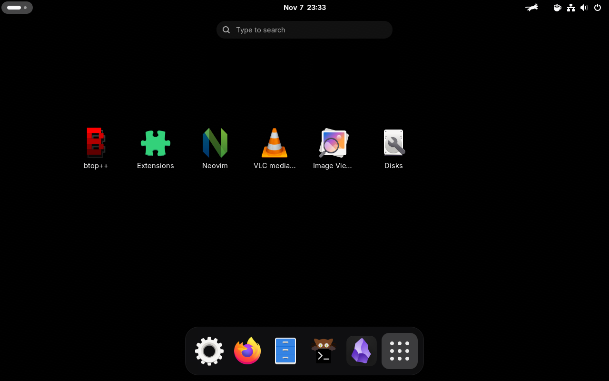

# Glacier

A minimal, dark-themed GNOME desktop OS built on **Fedora 45** with **KIWI NG**.
Bootable Live ISO with an **Anaconda** installer: try it live, or install to disk
for a standard mutable Fedora system (`dnf5` + Flatpak).




## Features

- Fedora 45 with GNOME 51 and `dnf5`
- Hybrid UEFI + BIOS Live ISO with `erofs` squashfs root
- Anaconda installer for disk installation
- Dark GNOME desktop: `adw-gtk3-dark`, Inter 11, JetBrains Mono 11
- Kitty terminal, pinned dock, GNOME Shell extensions (blur-my-shell, RunCat, Caffeine)
- Flathub + Obsidian installed on first boot

## Apps & Tools

Firefox, VLC, Loupe, Kitty, Nautilus, Neovim, Btop, Fastfetch, and more.
Full dev toolchain: gcc, clang, cmake, ninja, make, gdb, lldb, valgrind,
Python, Git, curl, wget.

## Building

Requires Podman or Docker:

```sh
./build.sh
```

Other modes: `--native` (Fedora host), `--boxbuild` (root-independent).
Output lands in `output/`.

## License

[MIT](LICENSE)
